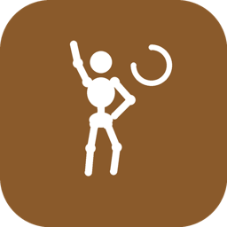
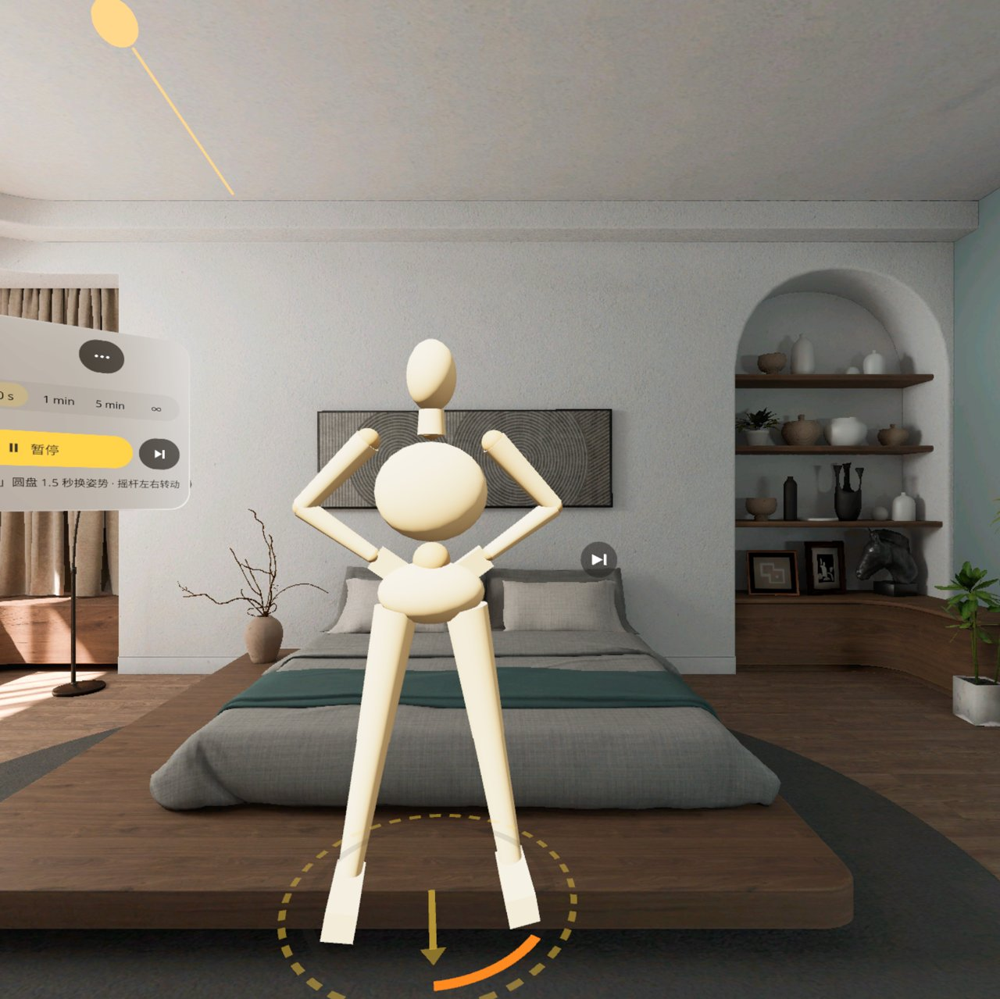
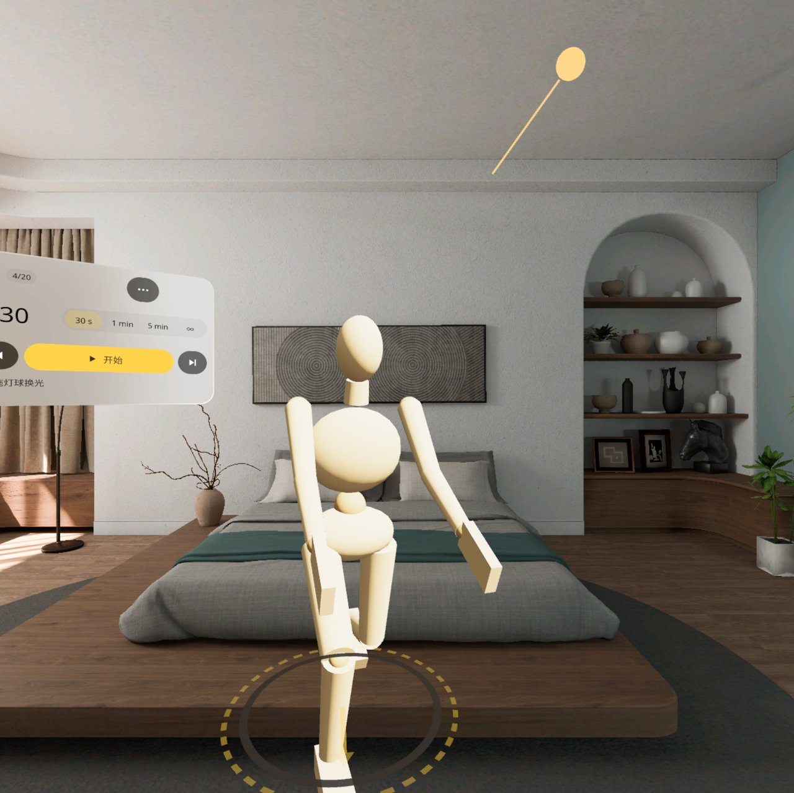
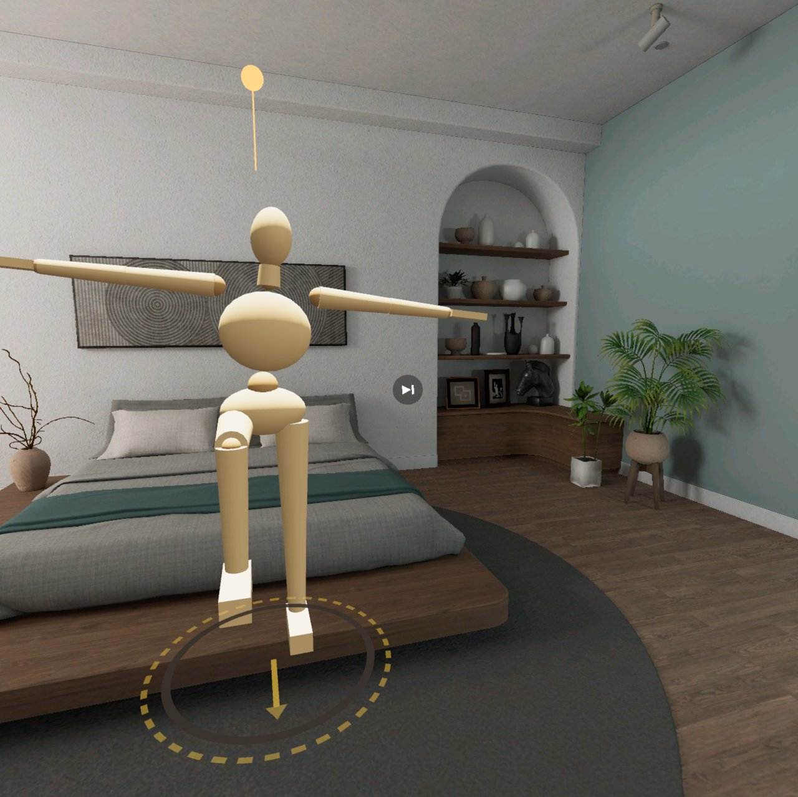
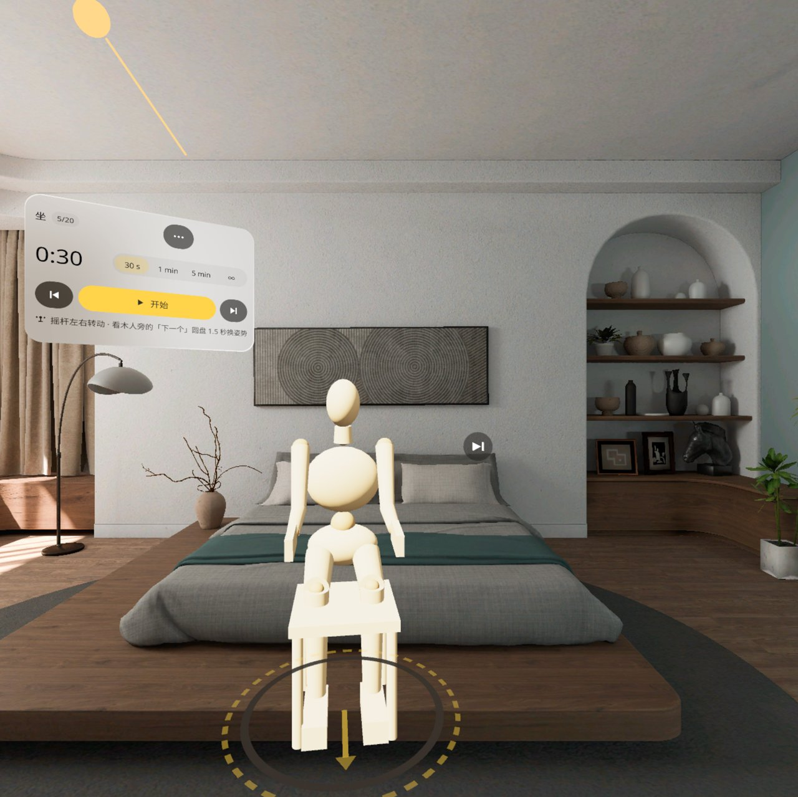
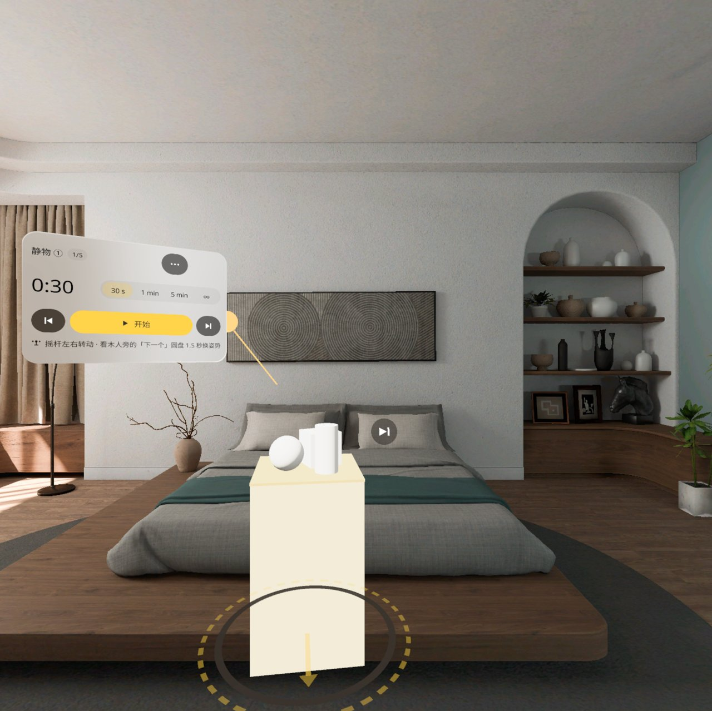
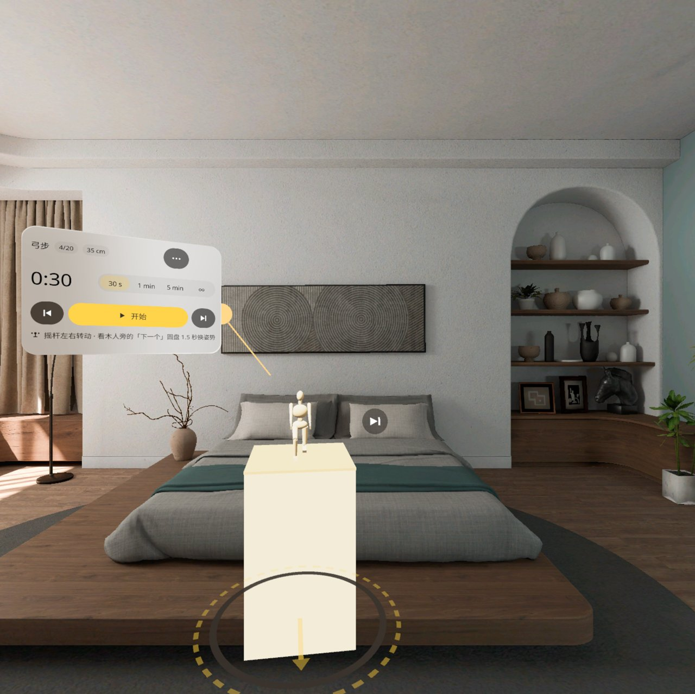
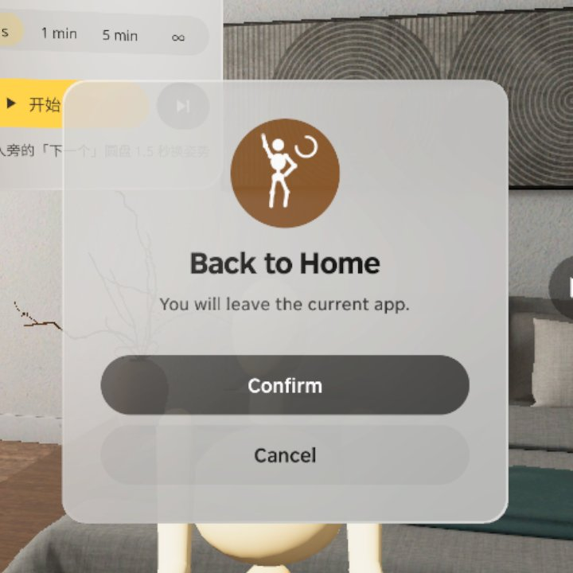
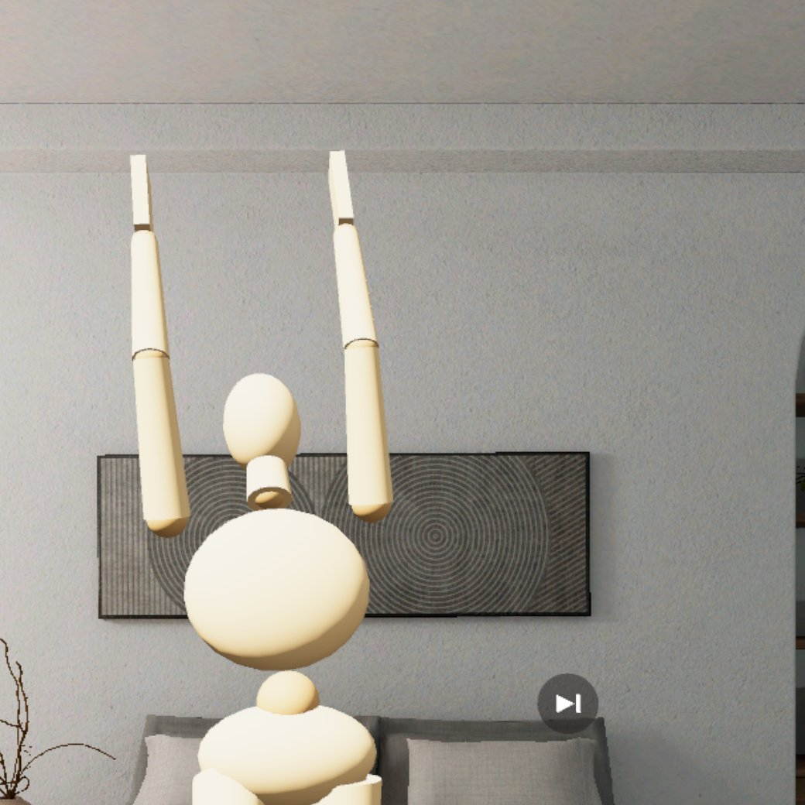

<p align="center"></p>

# Figure Model | 速写模特

**一个 1:1 的木制关节人站在你房间地板上，按 30 秒 / 1 分 / 5 分自动换姿势，你拿真本子真笔绕着它画。**

**A life-size wooden art mannequin stands on your real floor and changes pose every 30 s / 1 min / 5 min, while you walk around it and draw with real paper and pencil.**

PICO OS 6 · PICO Spatial SDK 6.1.9 · Kotlin / SpatialUI · package `io.embodit.figuremodel` · v0.1.0 (pre-release / 预发布)

> **模拟器 QA 通过，真机未验证（Simulator-QA passed; not yet verified on a real headset）。**


> 截图和演示视频来自原生模拟器（PICO Emulator 6.1），由调试广播和模拟器相机驱动；**非真实手势录像**，演示视频无声。
> Screenshots and the demo video were taken on the native PICO emulator, driven by debug broadcasts and the emulator camera; **not a recording of real hand gestures**; the demo video has no sound.

---

## 中文

### 这是什么

速写课上的模特，搬到你家。打开后地板上出现一个站位圈，一个和真人一样高的木制关节人站在上面；你拿真本子、真笔，可以绕着它走、蹲下、换角度画。选 30 秒、1 分钟、5 分钟或不限时，按开始后地上的计时环一点点缺下去，最后 5 秒变橙，时间到自动换下一个姿势（共 20 个，站、坐、跪、弓步、举手…坐姿自带一张木凳）。

两只手都在纸上时也能换姿势：看着木人旁边的「下一个」圆盘 1.5 秒就换。灯球可以拖，也可以在菜单里选左上、右上、正面、逆光、顶光，看明暗交界线怎么变。内容除了木人，还有石膏静物组和桌面上的小木人。木人可以捏住拖开、用摇杆转身，靠近站位圈会自动吸回去、朝向对齐。中英双语，不联网。

### 安装与启动

```bash
adb install -r FigureModel-v0.1.0.apk
pico-cli app launch io.embodit.figuremodel
```

APK 在 [Releases](https://github.com/kejing-dev/FigureModel/releases) 页面下载（仓库不含 APK）。需要 PICO OS 6 头显或 PICO Emulator 6.1；用到地板平面识别。APK 约 45 MB（内含完整中文字体）。木人周围留出约 2 米的空地，方便绕着走。

### 容器与骨架

- **容器**：只有 Full Space · `STAGE_MIXED`（透视），没有 Shared Space 版本。木人要 1:1 站在真实地板上让你绕着走，依赖地板平面识别，只在 Full Space 可用。
- **骨架 D**（同机器人工位 Robot Cell Fit / 火情预案 Fire Plan / 空间尺 Spatial Ruler）：平面识别、懒跟随面板、预建面板池、每帧系统。木人由代码拼成（球、圆锥台和自拼方块），20 个姿势是关节角度表，正运动学在 `Mannequin.kt`，脚底贴地、膝盖找平都有单元测试；SDK 方向光打光。开场的模型排队一个个建，避免主线程卡住。
- **状态**：设计包 18 个状态（S1–S18），全部可由调试广播直接跳转并截图，结构见 [AGENTS.md](AGENTS.md)。

### 截图

| | |
|---|---|
|  |  |
| 最后五秒 — 计时环最后一段变橙 | 调光 — 灯球移到右上，明暗换侧 |
|  |  |
| 看着「下一个」圆盘 1.5 秒换姿势 | 坐姿 — 自带木凳 |
|  |  |
| 静物 — 展台上的石膏组 | 桌面小人 — 小尺寸木人 |

启动器图标：



### 已知问题（QA 第 1 轮，不影响使用）

- **举手姿势时胳膊和肩膀之间有缝**：伸懒腰、举手这类胳膊举过头的姿势，上臂下端悬在头两侧，和身体之间露出空隙，看起来像胳膊断开；放下手的姿势正常。QA 建议下一版补肩部关节球，或把上臂接到肩点上。

  

- 控制面板在模拟器里常被挤到画面左边缘、露出一半（面板在视线左边 30°，木人挡住时再躲）；往左转一点头就看全，头显视野更大，要真机再看。
- 面板移动的一瞬间下面露出一条黑边，1–2 秒后自己补好。
- 空闲模拟器上首次打开约 36–40 秒木人才站好（模型排队一个个建，防「没有响应」）；头显上会快得多。
- 侧光时明暗差别小，正光和逆光差别明显。

还没在头显上验过：手柄摇杆转身和 A / X 键换姿势、捏住木人或灯球拖动的手感、真实房间里的灯光观感、真实眼高下的面板位置、站位圈放到真桌面上的小档。

---

## English

### What it is

The life-drawing class model, at home. A standing ring appears on your floor with a wooden articulated mannequin as tall as a person on it; with real paper and pencil you can walk around it, crouch and draw from any angle. Pick 30 s, 1 min, 5 min or no limit, press Start, and the timer ring on the floor runs down, turns orange for the last 5 s, and the next pose comes up (20 poses: standing, seated, kneeling, lunges, arms raised…; seated poses bring their own wooden stool).

With both hands on the paper you can still change pose: look at the "next" disc beside the mannequin for 1.5 s. Drag the light orb, or pick upper-left, upper-right, front, back or top light from the menu and watch the terminator move. Besides the mannequin there are plaster still-life sets and a small desk figure. Pinch-drag the mannequin away or turn it with the thumbstick; near the ring it snaps back in place and facing. Chinese and English, offline.

### Install and launch

```bash
adb install -r FigureModel-v0.1.0.apk
pico-cli app launch io.embodit.figuremodel
```

Download the APK from the [Releases](https://github.com/kejing-dev/FigureModel/releases) page (the repository itself does not ship an APK). Needs a PICO OS 6 headset or PICO Emulator 6.1; uses floor plane detection. The APK is about 45 MB because it bundles the full Chinese font. Leave about 2 m clear around the mannequin so you can walk around it.

### Container and skeleton

- **Container**: Full Space only, `STAGE_MIXED` (passthrough); no Shared Space version. The mannequin stands life-size on the real floor for you to walk around, which needs floor plane detection — Full Space only.
- **Skeleton D** (same as Robot Cell Fit / Fire Plan / Spatial Ruler): plane detection, lazy-follow panel, pooled panels, per-frame system. The mannequin is built in code (spheres, frustums and hand-built boxes); the 20 poses are joint-angle tables, forward kinematics live in `Mannequin.kt`, with unit tests for feet on the floor and knee levelling; lit by the SDK's directional light. Startup models are queued one by one so the main thread never stalls.
- **States**: 18 designed states (S1–S18), each reachable by a debug broadcast and captured; see [AGENTS.md](AGENTS.md).

### Screenshots

See the table above: last five seconds, side lighting, gaze-to-next, seated pose, still life, desk figure.

### Known issues (QA round 1, none blocking)

- **A gap between arm and shoulder in arms-raised poses**: in stretching / arms-up poses the upper arms hang beside the head with visible space between them and the body, as if the arms were detached; arms-down poses are fine. QA suggests a shoulder joint ball, or attaching the upper arm to the shoulder point, in the next version (picture above).
- On the emulator the control panel often sits half off the left edge of the view (it is 30° left of the gaze and dodges the mannequin); turn your head a little left to see it all. A headset has a wider view; to be checked on a device.
- When the panel moves, a black strip shows along its bottom for 1–2 s, then fills in.
- On an idle emulator the mannequin takes about 36–40 s to stand on first launch (models are queued one by one to avoid "not responding"); a headset is far faster.
- Side light gives only a small light / dark difference; front and back light differ clearly.

Not yet verified on a headset: thumbstick turning and A / X to change pose, the feel of pinch-dragging the mannequin or light orb, lighting in a real room, panel placement at a real eye height, and the small size on a real desk.

---

## License

Source code © 2026 Embodit. All rights reserved (private repository). Bundled fonts Noto Sans / Noto Sans SC are under the SIL Open Font License, see `third_party/`.
